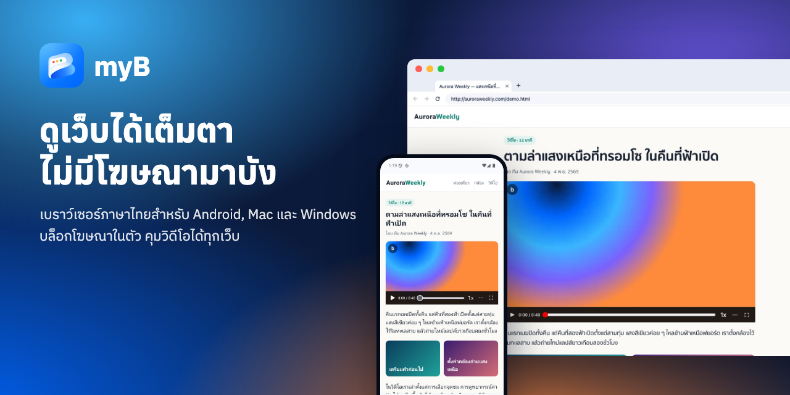
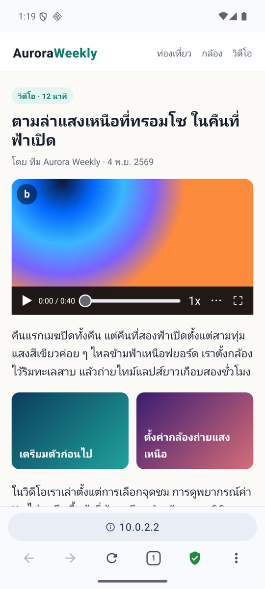
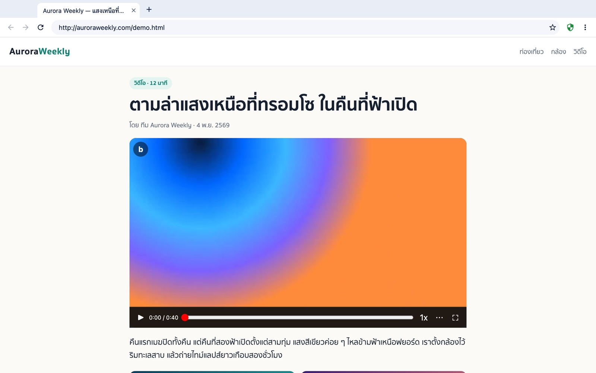
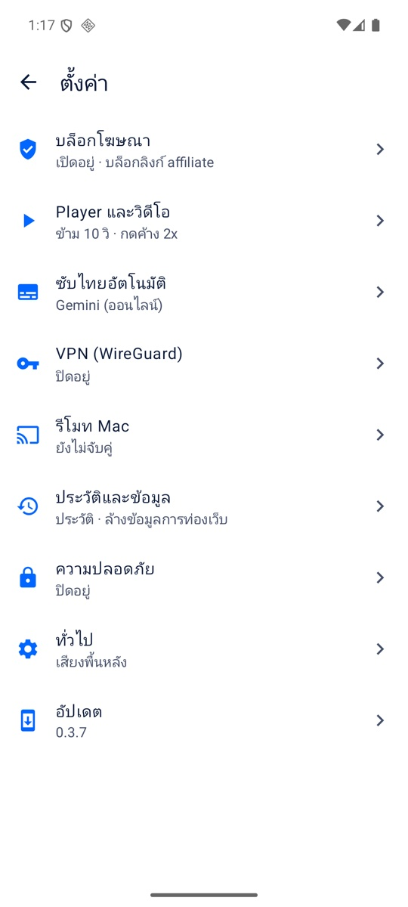
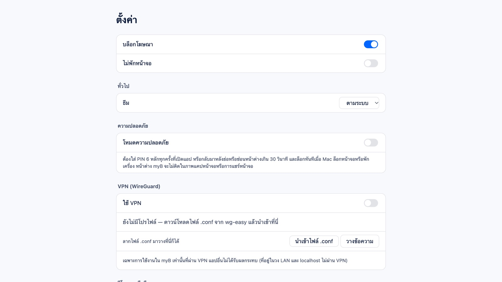

  

<h1 align="center">myB</h1>

  เบราว์เซอร์ภาษาไทยสำหรับ <b>Android</b>, <b>Mac</b> และ <b>Windows</b> บล็อกโฆษณาในตัว มี player ของตัวเองบนวิดีโอทุกเว็บ 
  ซับไทยอัตโนมัติ VPN (WireGuard) เฉพาะ myB และใช้มือถือเป็นรีโมทของคอมพิวเตอร์ได้ ใช้ฟรี ไม่ต้องสมัคร

  <a href="https://lazymodthai.github.io/myb-updates/"><b>เว็บไซต์ myB</b></a> ·
  <a href="https://github.com/lazymodthai/myb-updates/releases">ดาวน์โหลดทุกเวอร์ชัน</a> ·
  <a href="#ใช้มือถือเป็นรีโมทของ-mac">รีโมท Mac</a>

## ดาวน์โหลด

| | ไฟล์ | รองรับ |
|---|---|---|
| **Android** | `myB-<เวอร์ชัน>.apk` จาก release **myB for Android** ล่าสุด | Android 8 ขึ้นไป, 64-bit (arm64) |
| **Mac** | `myB-<เวอร์ชัน>-arm64.dmg` จาก release **myB for macOS** ล่าสุด | Mac ชิป Apple Silicon |
| **Windows** | `myB-Setup-<เวอร์ชัน>-x64.exe` จาก release **myB for Windows** ล่าสุด | Windows 10 และ 11, 64-bit |

หรือกดปุ่มดาวน์โหลดบน[เว็บไซต์](https://lazymodthai.github.io/myb-updates/) ซึ่งชี้ไปที่เวอร์ชันล่าสุดให้เอง
วิธีติดตั้งทีละขั้นอยู่ด้านล่าง ([Android](#myb-for-android) · [Mac](#myb-for-macos) · [Windows](#myb-for-windows))

## หน้าตา

<table>
  <tr>
    <td width="32%"></td>
    <td></td>
  </tr>
  <tr>
    <td>ปุ่ม <b>b</b> มุมซ้ายบนของวิดีโอทุกเว็บ เปิดแถบควบคุมของ myB</td>
    <td>หน้าตาเดียวกันบน Mac ใช้ ← → ข้าม, Space เล่น/หยุด, F เต็มจอ</td>
  </tr>
  <tr>
    <td></td>
    <td></td>
  </tr>
  <tr>
    <td>ตั้งค่าแบ่งเป็นหมวด</td>
    <td>บล็อกโฆษณา ธีม PIN และ VPN ในหน้าเดียว</td>
  </tr>
</table>

## จุดเด่น

- **บล็อกโฆษณาในตัว** AdGuard ร่วมกับตัวกรองของ myB สำหรับเว็บไทย (แบนเนอร์คาสิโน โฆษณาคั่นก่อนวิดีโอ)
- **Player บนวิดีโอทุกเว็บ** แตะสองครั้งเพื่อข้าม กดค้างเพื่อเล่น 2x แตะเลื่อนซ้ายขวาเพื่อเลื่อนเวลา บีบนิ้วเพื่อเต็มจอ
- **ซับไทยอัตโนมัติ** บน Android 10 ขึ้นไป
- **VPN (WireGuard) เฉพาะ myB** แอปอื่นไม่ได้รับผล VPN หลุดเมื่อไหร่ myB หยุดโหลดทันที
- **ล็อกด้วย PIN** ทุกเครื่อง
- **มือถือเป็นรีโมทของคอมพิวเตอร์** (Mac / Windows) ชี้เพื่อเลื่อนเคอร์เซอร์ พิมพ์จากมือถือ ส่งหน้าเว็บไปเปิดบนคอม
- **อัปเดตตัวเอง** เช็กวันละครั้ง บน Android โหลดแค่ส่วนที่เปลี่ยน

repo นี้ยังเก็บไฟล์ที่แอปใช้อัปเดตตัวเองด้วย (`update.json`, รายการกฎโฆษณา `filters/thai.txt`)
และหน้าเว็บไซต์ (`index.html`, `assets/`)

---

## myB for Android

### ติดตั้ง

1. เปิดหน้า Releases บนมือถือ แล้วดาวน์โหลด `myB-<เวอร์ชัน>.apk` จาก release **myB for Android** ล่าสุด
2. เปิดไฟล์ แล้วอนุญาต "ติดตั้งแอปที่ไม่รู้จัก" ให้แอปที่ใช้เปิดไฟล์ (เช่น Chrome หรือ Files)
3. รองรับ Android 8 ขึ้นไป บนเครื่อง 64-bit (arm64)

### อัปเดต

myB เช็กอัปเดตเองวันละครั้ง หรือกดเช็กเองได้ที่ **ตั้งค่า → อัปเดต** ถ้ามีเวอร์ชันใหม่จะขึ้นแถบแจ้ง
ถ้ามีเวอร์ชันก่อนหน้าติดตั้งอยู่ myB จะโหลดแค่ส่วนที่เปลี่ยน (patch) ไม่ต้องโหลดทั้งไฟล์ แล้วเปิดหน้าติดตั้งของ
Android ให้กดยืนยัน รายการกฎโฆษณาของ myB อัปเดตเองได้โดยไม่ต้องติดตั้งแอปใหม่

### ฟีเจอร์และวิธีใช้

- **บล็อกโฆษณา**
  - ใช้ AdGuard ที่ฝังในแอป และตัวกรองของ myB เองสำหรับเว็บหนัง/มังงะไทย (แบนเนอร์คาสิโน โฆษณาคั่นก่อนหนัง)
  - โล่ในแถบล่างบอกสถานะ แตะโล่เพื่อเปิดหน้าต่าง AdGuard ได้ เช่น ปิดการป้องกันบนเว็บนี้ หรือบล็อกองค์ประกอบเอง
  - เปิด/ปิดได้ที่ ตั้งค่า → บล็อกโฆษณา
  - **เว็บที่ยกเว้น:** ใน ตั้งค่า → บล็อกโฆษณา มี youtube.com ให้ตั้งแต่ต้น เพิ่ม/ลบเว็บได้เอง บนเว็บเหล่านี้ตัวกรองของ myB
    จะไม่ทำงาน ส่วน AdGuard ต้องปิดเองหนึ่งครั้ง: แตะโล่ → ปิดการป้องกันบนเว็บนี้ (ครั้งแรกที่เข้าเว็บจะมีแถบเตือนพร้อมปุ่ม
    "เปิด AdGuard")
- **บล็อกลิงก์ affiliate:** หน้าเว็บเปิดลิงก์ Shopee, TikTok หรือ Lazada เองไม่ได้ จะขึ้นแถบบอกว่าบล็อกอะไรไป
  และกด "เปิด" ได้ถ้าต้องการไปจริง ส่วน URL ที่พิมพ์เอง บุ๊กมาร์ก และประวัติ ไม่ถูกบล็อก แก้รายการโดเมนได้ใน ตั้งค่า
- **Player สำหรับวิดีโอทุกเว็บ**

  | ท่าทาง | ผล |
  |---|---|
  | แตะสองครั้งซ้าย / ขวา | ถอย / ข้ามไปข้างหน้า (ค่าเริ่มต้น 10 วินาที ปรับได้) แตะต่อเพื่อข้ามเพิ่ม |
  | แตะสองครั้งตรงกลาง | เล่น / หยุด |
  | แตะค้าง | เล่นเร็ว 2x ระหว่างที่ค้างไว้ (เลือก 1.5x / 3x ได้) |
  | แตะเลื่อนซ้ายขวา | เลื่อนเวลา |
  | บีบนิ้วออก / เข้า | เต็มจอ / ออกจากเต็มจอ (บีบเข้าบนวิดีโอขนาดปกติ = ภาพซ้อนภาพ) |
  | ปุ่ม "b" มุมซ้ายบนของวิดีโอ | แถบควบคุมของ myB: เล่น เวลา ความเร็ว ล็อกจอ หมุนจอ ภาพซ้อนภาพ เต็มจอ |

  ปิด player เฉพาะเว็บได้จาก ⋮ → "ปิด player บนเว็บนี้"
- **ซับไทยอัตโนมัติ** (Android 10 ขึ้นไป) ตั้งค่าได้ใน ตั้งค่า → ซับไทยอัตโนมัติ
- **VPN (WireGuard) เฉพาะ myB**
  - ไปที่ ตั้งค่า → VPN แล้วสแกน QR ของเครื่องลูกจาก wg-easy (หรือนำเข้าไฟล์ `.conf`) แล้วเปิด "ใช้ VPN"
  - myB จะไม่โหลดอะไรจนกว่าจะเชื่อม VPN ได้ ถ้า VPN หลุด ทุกแท็บจะหยุดจนกว่าจะกลับมา
  - แอปอื่นไม่ได้รับผล
- **โหมดความปลอดภัย:** ตั้ง PIN 6 หลักเพื่อล็อก myB ได้ที่ ตั้งค่า → ความปลอดภัย
- **ธีม:** ตั้งค่า → ทั่วไป → ธีม เลือก ตามระบบ / สว่าง / มืด หน้าเว็บที่รองรับโหมดมืดจะเปลี่ยนตาม
- **แตะค้างที่แถบที่อยู่:** มีเมนูให้ **บุ๊กมาร์ก** หน้านี้ หรือ **เปิดใน Mac** (เปิดหน้านี้เป็นแท็บใหม่บน Mac แล้วเข้าหน้ารีโมทให้เลย
  ถ้า Mac ไม่ได้เปิดอยู่จะแจ้ง "ไม่พบ Mac")
- **ตั้งค่า:** แบ่งเป็นหมวด (บล็อกโฆษณา, Player และวิดีโอ, ซับไทย, VPN, รีโมท Mac, ประวัติและข้อมูล, ความปลอดภัย,
  ทั่วไป, อัปเดต) แตะหมวดเพื่อเข้าไปตั้งค่า **ประวัติ** อยู่ใน ตั้งค่า → ประวัติและข้อมูล
- **ทั่วไป:** แท็บ, เมนูกดค้างที่ลิงก์, บุ๊กมาร์ก, ล้างข้อมูลการท่องเว็บ, ดาวน์โหลด และเล่นเสียงต่อเมื่อออกจากแอป
- **รีโมท Mac:** ดูหัวข้อ [ใช้มือถือเป็นรีโมทของ Mac](#ใช้มือถือเป็นรีโมทของ-mac) ด้านล่าง

---

## myB for macOS

### ติดตั้ง

1. ดาวน์โหลด `myB-<เวอร์ชัน>-arm64.dmg` จาก release **myB for macOS** ล่าสุด (สำหรับ Mac ชิป Apple Silicon)
2. เปิด dmg แล้วลาก myB ไปไว้ใน **Applications** ต้องอยู่ในโฟลเดอร์นี้ ไม่งั้นอัปเดตในแอปไม่ได้
3. ครั้งแรก macOS จะกันไว้ เพราะแอปไม่ได้ผ่าน notarization ของ Apple ให้**คลิกขวาที่ myB → เปิด → เปิด** (ทำครั้งเดียว)
   หรือรัน `xattr -dr com.apple.quarantine /Applications/myB.app`

### อัปเดต

myB เช็กอัปเดตเองวันละครั้ง หรือกดเช็กเองได้ที่ **ตั้งค่า → อัปเดต** ถ้ามีเวอร์ชันใหม่จะขึ้นปุ่ม "อัปเดต" ที่แถบเครื่องมือ
myB จะดาวน์โหลดและตรวจลายเซ็นให้เอง แล้วกด "รีสตาร์ทเพื่ออัปเดต"

### ฟีเจอร์และวิธีใช้

- **บล็อกโฆษณา**
  - ใช้รายการ AdGuard Base, Tracking Protection, URL Tracking และ EasyList Thailand ร่วมกับตัวกรองของ myB
  - ปิดการบล็อกเฉพาะเว็บได้จากปุ่มโล่บนแถบที่อยู่ หรือพิมพ์เพิ่มโดเมนที่ ตั้งค่า → เว็บที่ปิดบล็อกโฆษณา
    (มี youtube.com ให้ตั้งแต่ต้น ลบออกได้)
- **Player สำหรับวิดีโอทุกเว็บ**

  | การกด | ผล |
  |---|---|
  | ดับเบิลคลิกซ้าย / ขวา หรือ ← / → | ถอย / ข้าม (ค่าเริ่มต้น 10 วินาที) |
  | ดับเบิลคลิกตรงกลาง หรือ F | เต็มจอ |
  | Space | เล่น / หยุด |
  | กดค้าง | เล่นเร็ว 2x ระหว่างที่ค้างไว้ |
  | ลากซ้ายขวา หรือเลื่อนสองนิ้วบน trackpad ด้านข้าง | เลื่อนเวลา |
  | จีบนิ้วออก / เข้าบน trackpad | เต็มจอ / ออกจากเต็มจอ |
- **VPN (WireGuard) เฉพาะ myB:** ไปที่ ตั้งค่า → VPN แล้วนำเข้าไฟล์ `.conf` จาก wg-easy แล้วเปิด "ใช้ VPN"
  ไม่ต้องใช้สิทธิ์ผู้ดูแลระบบ และแอปอื่นไม่ได้รับผล มีป้าย "VPN" ที่แถบเครื่องมือบอกสถานะ
- **โหมดความปลอดภัย (PIN):** ตั้งค่า → ความปลอดภัย ล็อกเมื่อเปิดแอป เมื่อกลับมาหลังซ่อนไว้เกิน 30 วินาที เมื่อ Mac
  ล็อกหน้าจอ หรือกด ⌘⇧L
- **ธีม:** ตั้งค่า → ทั่วไป → ธีม เลือก ตามระบบ / สว่าง / มืด หน้าเว็บที่รองรับโหมดมืดจะเปลี่ยนตาม
- **เครื่องมือนักพัฒนา:** F12 หรือ ⌥⌘I (DevTools), ⌥⌘J (คอนโซล), ⌥⌘U (ดูซอร์ส)
  บนคีย์บอร์ด Mac อาจต้องกด fn+F12
- **ทั่วไป:** แท็บ, บุ๊กมาร์ก, ประวัติ, ดาวน์โหลด และหน้าต่างล็อกอินของเว็บ

---

## myB for Windows

### ติดตั้ง

1. ดาวน์โหลด `myB-Setup-<เวอร์ชัน>-x64.exe` จาก release **myB for Windows** ล่าสุด (Windows 10 และ 11, 64-bit)
2. เปิดไฟล์ ครั้งแรก Windows อาจขึ้น "Windows protected your PC" เพราะแอปยังไม่ได้เซ็นด้วยใบรับรองที่ต้องซื้อ
   ให้กด **More info** → **Run anyway**
3. myB ติดตั้งเองโดยไม่ต้องใช้สิทธิ์ผู้ดูแลระบบ แล้วเปิดให้ทันที มีไอคอนบนเดสก์ท็อปและใน Start

### อัปเดต

เหมือนบน Mac: myB เช็กอัปเดตเองวันละครั้ง หรือกดเช็กเองที่ **ตั้งค่า → อัปเดต** กด "อัปเดต" แล้ว "รีสตาร์ทเพื่ออัปเดต"
myB จะดาวน์โหลดตัวติดตั้ง ตรวจลายเซ็น แล้วติดตั้งทับและเปิดใหม่ให้เอง

### ฟีเจอร์

เหมือน myB for macOS ทุกอย่าง (บล็อกโฆษณา player VPN ล็อกด้วย PIN รีโมทจากมือถือ) ต่างแค่คีย์ลัดใช้ **Ctrl** แทน ⌘
และแถบเมนูซ่อนอยู่ กด **Alt** เพื่อแสดง

---

## ใช้มือถือเป็นรีโมทของ Mac

ควบคุม myB บน Mac จากมือถือได้แบบรีโมททีวี ชี้มือถือเพื่อเลื่อนเคอร์เซอร์ แตะเพื่อคลิก และพิมพ์ URL ได้
ตอนดูวิดีโอเต็มจอ มือถือจะเปลี่ยนเป็นปุ่มควบคุมวิดีโอให้เอง แตะช่องกรอกข้อความบน Mac แล้วพิมพ์จากคีย์บอร์ดมือถือได้
สลับแท็บบน Mac ได้ และส่งหน้าเว็บจากมือถือไปเปิดบน Mac ได้ ใช้ **myB for Android 0.3.7 ขึ้นไป** คู่กับ
**myB for macOS 0.2.2 ขึ้นไป** (สองเครื่องควรเป็นเวอร์ชันล่าสุดทั้งคู่)

### จับคู่ (ทำครั้งเดียว)

1. **บน Mac:** ตั้งค่า → **รีโมทจากมือถือ** → เปิดสวิตช์ จะมี QR ขึ้นมา
   - ครั้งแรก macOS จะถามเรื่อง "รับการเชื่อมต่อขาเข้า" และ "เครือข่ายในบ้าน (Local Network)" ให้กด**อนุญาต**
     เพื่อให้เชื่อมต่อตรงผ่าน Wi-Fi ได้ ถ้าไม่อนุญาตก็ยังใช้ได้ แต่จะต่อผ่านเซิร์ฟเวอร์แทน
2. **บนมือถือ:** ตั้งค่า → **รีโมท Mac** → **สแกน QR จาก Mac** แล้วสแกน QR บนจอ Mac
3. สองเครื่องจำการจับคู่ไว้ ครั้งต่อไปไม่ต้องสแกนใหม่ ถ้ากด **สร้างรหัสใหม่** บน Mac มือถือเครื่องเดิมจะใช้ไม่ได้
   ต้องสแกนใหม่

### ใช้งาน

บนมือถือเปิด **⋮ → รีโมท Mac** แล้วกด **เชื่อมต่อ** (จะเชื่อมต่อเมื่อกดเท่านั้น ไม่ใช้เครือข่ายจนกว่าจะกด)

- แถบด้านบน: ปุ่มกากบาท = ออกจากโหมดควบคุม (ตัดการเชื่อมต่อทันที), ปุ่มแท็บ = รายการแท็บบน Mac แตะเพื่อสลับ,
  ปุ่มปรับ = ความไวเคอร์เซอร์ (0.5×–2.0× มีผลทันที), ปุ่มตัดลิงก์ = ยกเลิกเชื่อมต่อ (กด เชื่อมต่อ ใหม่ได้โดยไม่ต้องสแกน QR)
- ออกจากหน้ารีโมท กลับหน้าหลัก สลับแอป ปิดจอ หรือปิดแอป = ตัดการเชื่อมต่อทันที
- **ส่งหน้าเว็บไปเปิดบน Mac:** ในเบราว์เซอร์บนมือถือ แตะค้างที่แถบที่อยู่ → **เปิดใน Mac** หน้านั้นจะเปิดเป็นแท็บใหม่บน Mac
  แล้วมือถือเปลี่ยนเป็นหน้ารีโมทให้ ถ้า Mac ล็อกอยู่ จะเปิดให้หลังปลดล็อก

- **โหมดตัวชี้**
  - ชี้มือถือไปทางจอเพื่อเลื่อนเคอร์เซอร์บน Mac (ใช้ไจโรสโคป ถ้าเครื่องไม่มีไจโรให้ลากนิ้วบนพื้นที่ทัชแพดแทน)
  - แตะบนพื้นที่ทัชแพด = คลิก ปัดขึ้นลง = เลื่อนหน้า
  - ปุ่มด้านล่าง: ย้อน, กลางจอ (ย้ายเคอร์เซอร์ไปกลางจอ), แท็บก่อน / แท็บถัด, พิมพ์
  - ช่องด้านบน: พิมพ์ URL หรือคำค้น แล้วกด Go บนคีย์บอร์ดเพื่อเปิดบน Mac
- **พิมพ์ลงช่องบน Mac:** คลิกช่องกรอกข้อความบน Mac (เช่น ช่องค้นหา) มือถือจะเปิดคีย์บอร์ดให้เอง พิมพ์อะไรก็ไปที่ช่องนั้น
  ปุ่ม Enter บนคีย์บอร์ด = กด Enter บน Mac, ปุ่มลบ = ลบตัวอักษรที่อยู่ในช่องบน Mac, ช่องรหัสผ่านจะแสดงเป็นจุด
  (ข้อความในช่องบน Mac ไม่ถูกส่งมาที่มือถือ) กด "เสร็จ" เพื่อปิดคีย์บอร์ด
- **โหมด player:** เมื่อวิดีโอบน Mac เต็มจอ มือถือจะแสดงปุ่ม เล่น/หยุด, ถอย/ข้าม (ตามวินาทีที่ตั้งในแอปมือถือ),
  แถบเลื่อนเวลา, ความเร็ว, เสียง, ตอนก่อนหน้า/ถัดไป (ถ้าเว็บนั้นมี เช่น bilibili), ออกจากเต็มจอ
  และปุ่มสลับกลับไปโหมดตัวชี้
- **บน Mac:** มีไอคอนมือถือที่แถบเครื่องมือระหว่างที่มือถือเชื่อมต่ออยู่ ถ้า myB หรือหน้าจอ Mac ล็อกอยู่ รีโมทจะไม่ทำอะไร
  (มือถือขึ้นว่า "Mac ล็อกอยู่")

### การเชื่อมต่อและความปลอดภัย

- ถ้าอยู่ Wi-Fi เดียวกัน มือถือจะต่อตรงกับ Mac (เร็วที่สุด) ถ้าอยู่คนละเครือข่าย เช่น มือถือใช้เน็ตมือถือ จะต่อผ่าน
  เซิร์ฟเวอร์กลาง ถ้าเปิด VPN ของ myB บนมือถืออยู่ ส่วนใหญ่จะต่อผ่านเซิร์ฟเวอร์
- ทุกข้อความเข้ารหัสตั้งแต่ต้นทางถึงปลายทางด้วยกุญแจที่ได้จาก QR และเปลี่ยนกุญแจใหม่ทุกครั้งที่เชื่อมต่อ
  เซิร์ฟเวอร์และเครือข่ายระหว่างทางอ่านไม่ได้ว่าทำอะไร
- ใช้ได้ทีละหนึ่งเครื่อง ถ้ามีมือถืออีกเครื่องเชื่อมต่อเข้ามา เครื่องที่เข้ามาใหม่จะใช้งานแทน เครื่องเดิมจะขึ้นว่า
  "มีมือถืออีกเครื่องเชื่อมอยู่" และกด เชื่อมต่อ ใหม่ได้
- Mac ที่เปิดสวิตช์ "รีโมทจากมือถือ" ไว้จะรอการเชื่อมต่อด้วยการเชื่อมต่อเบา ๆ กับเซิร์ฟเวอร์ (แทบไม่ใช้ทรัพยากร) ปิดสวิตช์ได้เมื่อไม่ใช้

---

## Third-party

myB ใช้ [AdGuard Browser Extension](https://github.com/AdguardTeam/AdguardBrowserExtension) (LGPL-3.0)
โดยไม่ได้แก้ไข ซอร์สโค้ดอยู่ที่ลิงก์ด้านบน, [GeckoView](https://mozilla.github.io/geckoview/) (MPL-2.0) บน Android,
[Electron](https://www.electronjs.org/) และ [ghostery adblocker](https://github.com/ghostery/adblocker) (MPL-2.0) บน macOS
และ [wireguard-go](https://git.zx2c4.com/wireguard-go/) (MIT) สำหรับ VPN บน Mac
